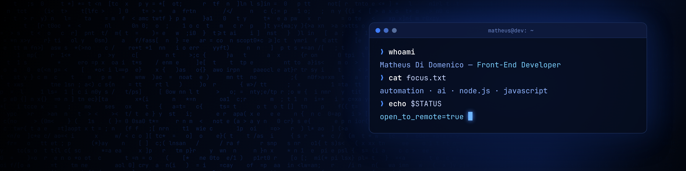

## Hi, I'm Matheus 👋

**Front-End Developer** focused on **automation** and **AI**, studying Software Engineering at [UNIVATES](https://www.univates.br/) (Brazil, expected 2029).

I like building clean, user-friendly interfaces and turning repetitive, manual work into simple tools. Before moving into development, I worked in **IT infrastructure & support at Sicredi**, so I also know how real systems run and how to troubleshoot them.

- 📓 Learning: **React**, **Next.js** and integrating **AI APIs** into real apps
- 🌎 Open to **remote** internship / junior roles (Brazil or abroad)
- 🗣️ English: **C2** (certified) · Portuguese: native

### 🛠️ Tech stack

**Front-end**

**Back-end & data**

**Infra & tools**

-1BA0D7?style=flat-square&logo=cisco&logoColor=white)

### 📫 Let's connect

